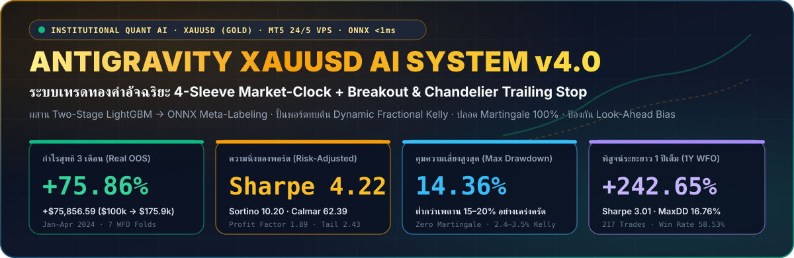
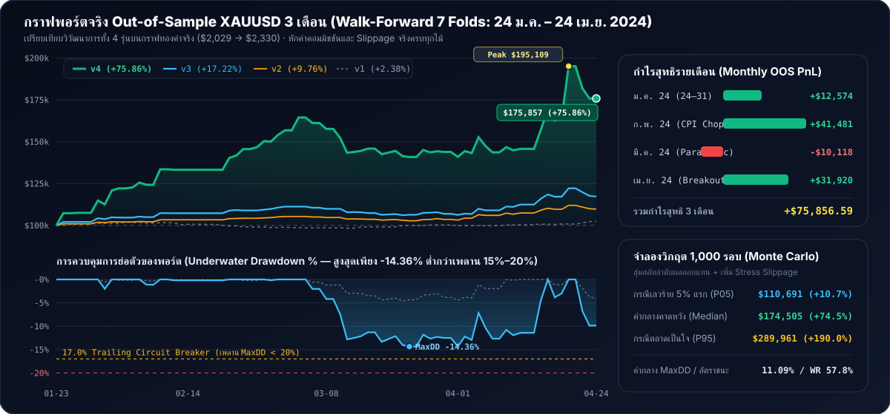
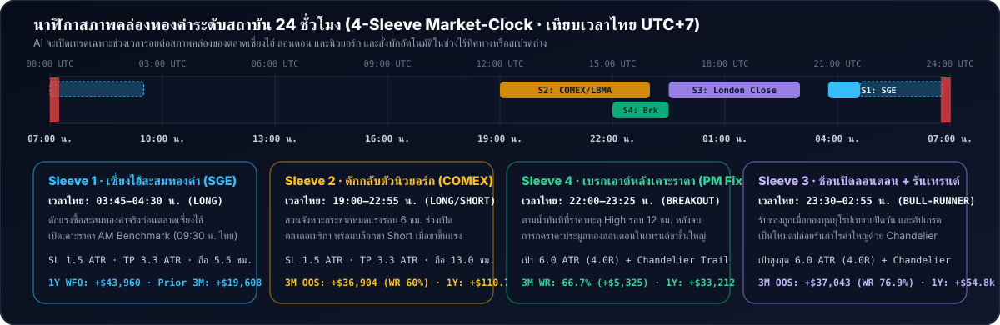
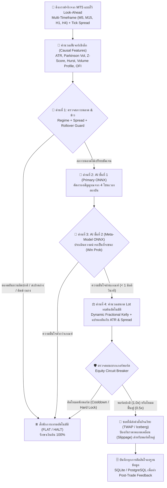
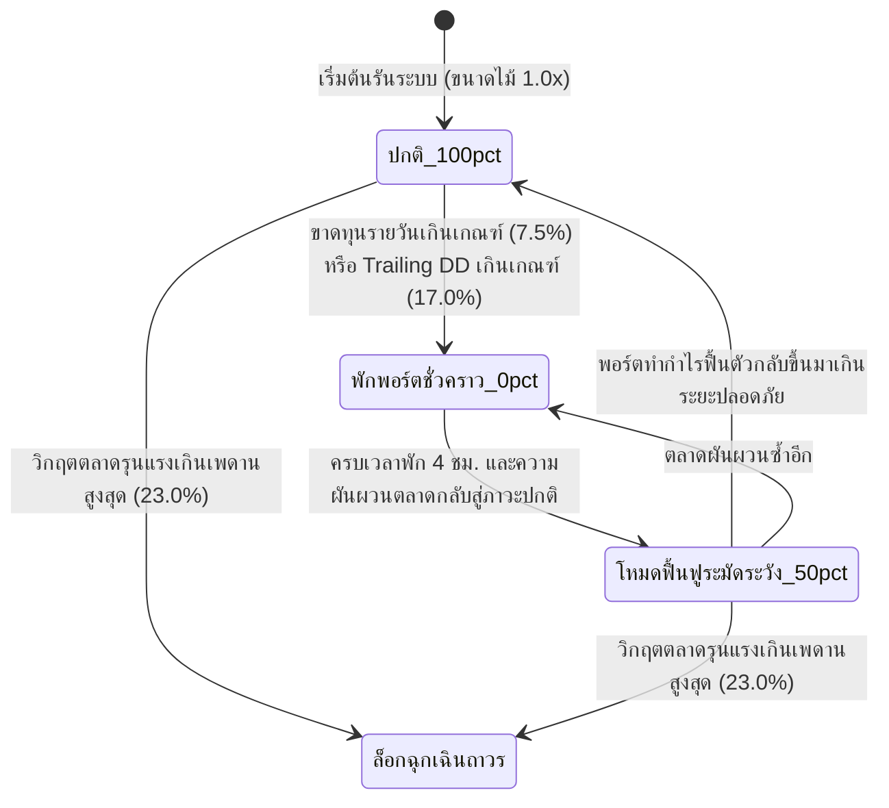

<p align="center">
  
</p>

<p align="center">
  <a href="#-ผลลัพธ์การทดสอบจริง-real-xauusd-out-of-sample"><strong>📊 ผลทดสอบจริง (+75.86%)</strong></a> ·
  <a href="#-กลยุทธ์-4-โซนเวลาสถาบันโลก-4-sleeve-market-clock"><strong>🧭 กลยุทธ์ 4 โซนเวลาไทย</strong></a> ·
  <a href="#-สถาปัตยกรรม-ai--ระบบนิรภัย-4-ชั้น"><strong>🧠 สถาปัตยกรรม AI &amp; นิรภัย</strong></a> ·
  <a href="#-เริ่มต้นใช้งานใน-5-นาที-step-by-step"><strong>🚀 วิธีติดตั้งใน 5 นาที</strong></a> ·
  <a href="#-สูตรตั้งค่าความเสี่ยงสำเร็จรูป-3-สไตล์-risk-presets"><strong>⚙️ สูตรตั้งค่า 3 สไตล์</strong></a> ·
  <a href="docs/USER_GUIDE_TH.md"><strong>📘 คู่มือปฏิบัติการ VPS ฉบับเต็ม</strong></a>
</p>

---

## ✨ ทำไมระบบนี้ถึงแตกต่างจากบอทเทรดทองทั่วไป? (อ่านจบเข้าใจใน 1 นาที)

บอทเทรดทองคำส่วนใหญ่ในตลาดมักใช้ระบบ **แก้ไม้ / ถัวเฉลี่ยขาดทุน (Martingale / Grid)** ซึ่งดูเหมือนชนะบ่อยในช่วงไซด์เวย์ แต่เมื่อทองคำวิ่งเป็นเทรนด์ยาวเพียงครั้งเดียว พอร์ตจะพังทลายทันที

**Antigravity XAUUSD AI System v4.0** ถูกออกแบบใหม่ตั้งแต่ระดับรากฐาน (**First Principles**) ตามมาตรฐานกองทุนเชิงปริมาณระดับสถาบัน (Institutional Quantitative Architecture) โดยมี **3 เสาหลักสำคัญ**:

| มิติการเปรียบเทียบ | ❌ บอทเทรดทั่วไป (Grid / Martingale) | ✅ Antigravity XAUUSD AI v4.0 |
| :--- | :--- | :--- |
| **วิธีจัดการเมื่อผิดทาง** | เบิ้ลหลอตสู้สวนเทรนด์ เสี่ยงล้างพอร์ต 100% | **Zero Martingale 100%** มี Stop Loss ตามความผันผวนจริง (`1.5 ATR`) ทุกไม้ |
| **จังหวะการเข้าเทรด** | เปิดออเดอร์มั่วตลอด 24 ชม. โดนกินเรียบช่วงไซด์เวย์ | เทรดเฉพาะ **4 ช่วงเวลารอยต่อสภาพคล่องโลก** (เซี่ยงไฮ้ · ลอนดอน · นิวยอร์ก) |
| **สมองกลคัดกรองสัญญาณ** | อินดิเคเตอร์พื้นๆ ทั่วไป (RSI / MACD ตัดกัน) | **AI สองชั้น (Two-Stage LightGBM → ONNX `< 1ms`)** ประเมินโอกาสชนะก่อนยิงคำสั่ง |
| **การกินกำไรคำใหญ่** | รีบปิดทำกำไรสั้นนิดเดียว แต่เวลาโดนลากถือยาว | มี **Chandelier Trailing Stop** ล็อกหน้าทุนอัตโนมัติและปล่อยรันเทรนด์ยาวถึง **`4.0R`** |
| **ระบบป้องกันพอร์ตพัง** | ปล่อยลากจน Margin Call | มี **Circuit Breaker อัตโนมัติ** สั่งพักเทรดทันทีเมื่อพอร์ตย่อแตะเกณฑ์ พร้อมโหมดลดขนาดไม้ครึ่งหนึ่งช่วงฟื้นฟู |

> [!IMPORTANT]
> **ปราศจากการแอบดูอนาคต 100% (Zero Look-Ahead Bias):** ทุกฟีเจอร์ของระบบใช้ข้อมูลแท่งเทียนที่ **ปิดแท่งสมบูรณ์แล้วเท่านั้น (`close_time <= t`)** พร้อมชุดทดสอบอัตโนมัติ (`pytest` 17 ข้อ) ตรวจสอบความถูกต้องของสูตรคำนวณทุกครั้งก่อนใช้งานจริง

---

## 📊 ผลลัพธ์การทดสอบจริง (Real `XAUUSD` Out-of-Sample)

ทดสอบแบบ **Walk-Forward Optimization (เทรนใหม่และทดสอบเดินหน้าทีละช่วงบนข้อมูลที่โมเดลไม่เคยเห็นมาก่อน 100%)** หักค่าคอมมิชชัน (`$3.50/lot`) และ Slippage จริงครบทุกไม้ บนข้อมูลราคาทองคำจริง (`XAUUSD` จาก `$2,029` สู่ `$2,330`):

<p align="center">
  
</p>

### ตารางเปรียบเทียบวิวัฒนาการของระบบทั้ง 4 รุ่น (ทุนเริ่มต้น `$100,000`)

| ตัวชี้วัดหลัก (OOS 3 เดือน: `24 ม.ค. – 24 เม.ย. 2024`) | รุ่น v1 (Baseline) | รุ่น v2 (Ultra-Low Vol) | รุ่น v3 (Balanced Kelly) | 🏆 **รุ่น v4 (4-Sleeve + Chandelier)** |
| :--- | :---: | :---: | :---: | :---: |
| **กำไรสุทธิ (Net Profit)** | `+$2,378.09` | `+$9,755.00` | `+$17,222.84` | **`+$75,856.59`** |
| **ผลตอบแทนรวม (3 เดือน)** | `+2.38%` | `+9.76%` | `+17.22%` | **`+75.86%`** |
| **มูลค่าพอร์ตสิ้นสุด (Final Equity)** | `$102,378.09` | `$109,755.00` | `$117,222.84` | **`$175,856.59`** |
| **การย่อตัวสูงสุด (Max Drawdown)** | `3.58%` | `2.41%` | `4.62%` | **`14.36%`** *(ต่ำกว่าเพดาน 15–20%)* |
| **ความนิ่งของพอร์ต (Sharpe / Sortino)** | `0.69` / `0.85` | `3.79` / `7.64` | `3.95` / `8.21` | **`4.22` / `10.20`** |
| **Calmar Ratio / Tail Ratio** | `2.86` / `1.04` | `18.69` / `1.34` | `19.70` / `1.35` | **`62.39` / `2.43`** |
| **Profit Factor / อัตราชนะ (Win Rate)** | `1.12` / `45.5%` | `1.80` / `56.8%` | `1.80` / `56.76%` | **`1.89` / `57.75%`** (`71` ไม้) |
| **ทดสอบช่วงก่อนหน้า 3 เดือน (`ต.ค. 23 – ม.ค. 24`)** | — | `+0.21%` | `-0.19%` | **`+12.31%`** (`MaxDD 16.03%`) |
| **ทดสอบระยะยาว 1 ปีเต็ม (`ต.ค. 22 – ก.ย. 23`)** | — | `+21.40%` | `+43.23%` | **`+242.65%`** (`Sharpe 3.01`, `217` ไม้) |

---

## 🧭 กลยุทธ์ 4 โซนเวลาสถาบันโลก (4-Sleeve Market-Clock)

ทองคำไม่ได้วิ่งแบบไร้เหตุผล แต่ขับเคลื่อนด้วย **กระแสเงินทุนของธนาคารกลาง ตลาดทองคำแท่งเซี่ยงไฮ้ (SGE) การประมูลราคาทองคำลอนดอน (LBMA Fix) และตลาดฟิวเจอร์สนิวยอร์ก (COMEX)** ระบบจึงแบ่งเครื่องยนต์ทำกำไรออกเป็น **4 กลยุทธ์อิสระ (4 Sleeves)** ตามเวลาจริงดังนี้:

<p align="center">
  
</p>

| โซนกลยุทธ์ (Sleeve) | เวลาประเทศไทย (`UTC+7`) | เวลาสากล (`UTC`) | หลักการทำกำไรแบบเข้าใจง่าย | ระบบจัดการเป้ากำไร & Trailing Stop |
| :--- | :---: | :---: | :--- | :--- |
| **1. เซี่ยงไฮ้สะสมทองคำ**<br>*(Shanghai SGE Fix)* | **`03:45 – 04:30 น.`**<br>*(ถือถึง ~09:30 น.)* | `20:45 – 21:30` | ดักแรงซื้อสะสมทองคำจริงก่อนตลาดเซี่ยงไฮ้เปิดเคาะราคา AM Fix ตอนเช้า | `SL 1.5 ATR` · `TP 3.3 ATR` (`2.2R`)<br>ถือสูงสุด `5.5 ชม.` |
| **2. ดักกลับตัวนิวยอร์ก**<br>*(COMEX / LBMA Exhaustion)* | **`19:00 – 22:55 น.`** | `12:00 – 15:55` | ดักสวนจังหวะกองทุนไล่ราคาจนหมดแรงช่วงเปิดตลาดสหรัฐฯ *(บล็อกขา Short อัตโนมัติเมื่อเทรนด์ขาขึ้นแรง)* | `SL 1.5 ATR` · `TP 3.3 ATR` (`2.2R`)<br>ถือสูงสุด `13.0 ชม.` |
| **3. ช้อนปิดยุโรป + รันเทรนด์**<br>*(London-Close Bull-Runner)* | **`23:30 – 02:55 น.`** | `16:30 – 19:55` | ช้อนซื้อจังหวะกองทุนยุโรปเทขายปรับพอร์ตปิดวัน และสลับเข้าโหมดรันเทรนด์ทันทีเมื่อขาขึ้นชัดเจน | **Chandelier Mode (`4.0R` / `6.0 ATR`)**<br>ล็อกหน้าทุน + เลื่อน SL เกาะเทรนด์ `9 ชม.` |
| **4. เบรกเอาต์หลังเคาะราคา**<br>*(Post-LBMA 12h Breakout)* | **`22:00 – 23:25 น.`** | `15:00 – 16:25` | ตามน้ำทันทีที่ราคาทะลุจุดสูงสุดรอบ 12 ชม. หลังจบการกดราคาประมูลทองลอนดอน (LBMA PM Fix) | **Chandelier Mode (`4.0R` / `6.0 ATR`)**<br>ล็อกหน้าทุน + เลื่อน SL เกาะเทรนด์ `8 ชม.` |

> [!TIP]
> **กลไก Chandelier Trailing Stop อัจฉริยะทำงานอย่างไร?**
> 1. เมื่อกำไรวิ่งแตะ **`+1.55R`**: ระบบขยับ Stop Loss ขึ้นมาล็อกกำไรหน้าทุนที่ **`+0.25R`** ทันที (การันตีไม่ขาดทุนไม้นั้นแน่นอน)
> 2. เมื่อกำไรวิ่งแตะ **`+1.95R`**: ระบบเปิดโหมด **Chandelier Trailing Stop** เลื่อนจุดล็อกกำไรไล่ตามจุดสูงสุดใหม่ห่าง **`1.50 ATR`** เพื่อกินคำใหญ่สุดเทรนด์สูงสุดถึง **`4.0R` (`6.0 ATR`)**!

---

## 🧠 สถาปัตยกรรม AI & ระบบนิรภัย 4 ชั้น

### 1. ผังการทำงานครบวงจร (End-to-End System Pipeline)



### 2. วงจรเบรกเกอร์นิรภัยพิทักษ์เงินต้น (Equity Curve Circuit Breaker)



---

## 🚀 เริ่มต้นใช้งานใน 5 นาที (Step-by-Step)

### ขั้นตอนที่ 1: ติดตั้งโปรแกรมและไลบรารี

รองรับ **Python 3.10 – 3.12** *(สำหรับการรันเทรดจริงเชื่อมต่อโปรแกรม MetaTrader 5 แนะนำให้ใช้ **Windows 10/11 หรือ Windows Server VPS** เนื่องจากแพ็กเกจ `MetaTrader5` อย่างเป็นทางการรองรับระบบ Windows)*

**สำหรับ Windows (PowerShell บนเครื่องคอมพิวเตอร์หรือ VPS):**
```powershell
git clone https://github.com/saengpech-sys/education.git
cd education
python -m venv .venv
.\.venv\Scripts\Activate.ps1
pip install -r requirements.txt
pip install MetaTrader5
```

**สำหรับ macOS / Linux (สำหรับวิจัย ทดสอบระบบ และรัน Walk-Forward Backtest):**
```bash
git clone https://github.com/saengpech-sys/education.git
cd education
python3 -m venv .venv
source .venv/bin/activate
pip install -r requirements.txt
```

---

### ขั้นตอนที่ 2: ตรวจสอบความสมบูรณ์ของระบบ (17 Unit & Integration Tests)

รันคำสั่งเดียวเพื่อตรวจสอบสูตรคำนวณ Lot Size, ระบบเบรกเกอร์, โมเดล ONNX และการป้องกันการแอบดูอนาคต:

```bash
pytest -v
```

---

### ขั้นตอนที่ 3: เลือกโหมดการรันที่ต้องการ (มีครบทั้ง 3 โหมดในคำสั่งเดียว!)

#### 🧪 โหมดที่ 1: ทดสอบระบบครบวงจรแบบจำลอง (`demo-pipeline` — ไม่ต้องเปิด MT5)
เหมาะสำหรับทดสอบการทำงานตั้งแต่ต้นจนจบ (Walk-Forward + จำลองวิกฤต Monte Carlo 1,000 รอบ + ส่งออกโมเดล `.onnx` + บันทึกฐานข้อมูล `SQLite`):
```bash
python main.py --mode demo-pipeline --bars 30000
```

#### 🎓 โหมดที่ 2: ดึงกราฟทองจริงจากโบรกเกอร์ MT5 มาเทรนสมองกล AI (`train-mt5`)
เปิดโปรแกรม **MetaTrader 5** ทิ้งไว้ ตั้งค่ารหัสผ่านผ่านตัวแปรสภาพแวดล้อม แล้วสั่งให้ระบบดึงกราฟ `XAUUSD` จริงจากโบรกเกอร์ของคุณมาทดสอบและสร้างไฟล์สมองกล `.onnx` ลงโฟลเดอร์ `artifacts/onnx_models/` อัตโนมัติ:
```powershell
$env:MT5_LOGIN="12345678"
$env:MT5_PASSWORD="รหัสผ่าน_MT5_ของคุณ"
$env:MT5_SERVER="ชื่อเซิร์ฟเวอร์โบรกเกอร์ของคุณ"

python main.py --mode train-mt5 --bars 30000
```

#### ⚡ โหมดที่ 3: เปิดบอทเทรดจริงบน VPS ตลอด 24 ชั่วโมง 5 วันทำการ (`live-mt5`)
เมื่อมีไฟล์สมองกล `.onnx` พร้อมแล้ว สั่งรันบอทเชื่อมต่อพอร์ตจริง (หรือพอร์ต Demo เพื่อดูพฤติกรรมก่อนลงเงินจริง) ได้ทันที:
```powershell
python main.py --mode live-mt5 --config config.yaml
```
*(หากต้องการหยุดบอทอย่างปลอดภัย ให้กด `Ctrl + C` ระบบจะปิดการเชื่อมต่อ MT5 และบันทึกฐานข้อมูลให้เรียบร้อยอัตโนมัติ)*

---

## ⚙️ สูตรตั้งค่าความเสี่ยงสำเร็จรูป 3 สไตล์ (`Risk Presets`)

คุณสามารถปรับนิสัยความแรงของพอร์ตได้ง่ายๆ เพียงเปิดไฟล์ [`config.yaml`](config.yaml) ในหมวด `risk_and_scaling:` แล้วเลือกก๊อปปี้สูตรที่ตรงกับเป้าหมายของคุณ:

<details open>
<summary><strong>🚀 สไตล์ที่ 1: สายปั้นพอร์ตโตเร็วทบต้น (High-Growth Geometric Mode — ค่าเริ่มต้นปัจจุบัน v4)</strong></summary>

เหมาะสำหรับพอร์ตส่วนตัวที่ต้องการเร่งการเติบโตแบบทบต้น (`+75.86%` ใน 3 เดือน OOS) โดยคุม Max Drawdown ไม่ให้เกิน `15%–20%`:
```yaml
risk_and_scaling:
  min_risk_per_trade_pct: 0.0240         # ความเสี่ยงขั้นต่ำ 2.40% ต่อไม้เมื่อผ่านเกณฑ์ความมั่นใจ AI
  max_risk_per_trade_pct: 0.0350         # เพดานความเสี่ยงสูงสุดไม่เกิน 3.50% ต่อไม้ (ไร้ Martingale)
  kelly_fraction: 0.35                   # สัดส่วน Fractional Kelly เชิงรุกแบบปลอดภัย
  target_annual_volatility: 0.38         # เป้าความผันผวนขาลงต่อปี 38%
  daily_drawdown_limit_pct: 0.075        # ขาดทุนรายวันแตะ 7.5% -> สั่งพักพอร์ตทันที
  max_trailing_drawdown_limit_pct: 0.170 # ย่อตัวสะสมแตะ 17.0% -> สั่งพักพอร์ตและลดขนาดไม้ครึ่งหนึ่ง
  hard_lock_drawdown_limit_pct: 0.230    # ล็อกฉุกเฉินถาวรที่ 23.0%
```
</details>

<details>
<summary><strong>⚖️ สไตล์ที่ 2: สายสมดุล เติบโตมั่นคง สบายใจ (Balanced Compounding Mode — รุ่น v3)</strong></summary>

เหมาะสำหรับผู้ที่ต้องการผลตอบแทนเฉลี่ยระดับ `+15%–20%` ต่อไตรมาส โดยพอร์ตย่อตัวต่ำมาก (`MaxDD ~4.62%`):
```yaml
risk_and_scaling:
  min_risk_per_trade_pct: 0.0050         # ความเสี่ยงขั้นต่ำ 0.50% ต่อไม้
  max_risk_per_trade_pct: 0.0100         # เพดานความเสี่ยงสูงสุดไม่เกิน 1.00% ต่อไม้
  kelly_fraction: 0.25                   # Quarter-Kelly มาตรฐานกองทุน
  target_annual_volatility: 0.14         # เป้าความผันผวนขาลงต่อปี 14%
  daily_drawdown_limit_pct: 0.025        # ขาดทุนรายวันแตะ 2.5% -> สั่งพักพอร์ตทันที
  max_trailing_drawdown_limit_pct: 0.0565 # ย่อตัวสะสมแตะ 5.65% -> สั่งพักพอร์ตทันที
  hard_lock_drawdown_limit_pct: 0.080    # ล็อกฉุกเฉินถาวรที่ 8.0%
```
</details>

<details>
<summary><strong>🛡️ สไตล์ที่ 3: สายสอบกองทุน Prop Firm / กองทุนความผันผวนต่ำพิเศษ (Ultra-Low Vol Mode — รุ่น v2)</strong></summary>

ออกแบบมาเพื่อกฎเหล็กของ **Prop Firm (เช่น Daily DD ห้ามเกิน 4–5% และ Max DD ห้ามเกิน 8–10%)** โดยเฉพาะ (`MaxDD จริงเพียง 2.41%`, `Sharpe 3.79`):
```yaml
risk_and_scaling:
  min_risk_per_trade_pct: 0.0025         # ความเสี่ยงขั้นต่ำเพียง 0.25% ต่อไม้
  max_risk_per_trade_pct: 0.0050         # เพดานความเสี่ยงสูงสุดไม่เกิน 0.50% ต่อไม้
  kelly_fraction: 0.25                   # Quarter-Kelly เน้นความนิ่งสูงสุด
  target_annual_volatility: 0.08         # เป้าความผันผวนขาลงต่อปีต่ำเพียง 8%
  daily_drawdown_limit_pct: 0.015        # ขาดทุนรายวันแตะ 1.5% -> หยุดเทรดทันที!
  max_trailing_drawdown_limit_pct: 0.040 # ย่อตัวสะสมแตะ 4.0% -> หยุดเทรดและลดหลอตครึ่งหนึ่ง!
  hard_lock_drawdown_limit_pct: 0.060    # ล็อกฉุกเฉินถาวรที่ 6.0%
```
</details>

---

## 🗂️ แผนผังโครงสร้างโปรเจกต์ (System Directory Tree)

```text
education/
├── config.yaml                          # ⚙️ ศูนย์รวมการตั้งค่าระบบ ความเสี่ยง และเวลาตลาดทั้งหมดในที่เดียว
├── main.py                              # 🚀 ตัวรันหลัก 24/5 VPS Orchestrator (รองรับ demo-pipeline / train-mt5 / live-mt5)
├── requirements.txt                     # 📦 รายการไลบรารีที่จำเป็นทั้งหมด
├── pyproject.toml                       # 🧪 ตั้งค่าแพ็กเกจและระบบทดสอบ pytest
│
├── core/                                # 🧱 โครงสร้างข้อมูลกลางและตัวตรวจความถูกต้องของ Config
│   ├── contracts.py                     #    - Dataclasses, Enums และมาตรฐานการเชื่อมต่อ MT5
│   └── config_loader.py                 #    - โหลด config.yaml พร้อมดักจับค่าความเสี่ยงที่ผิดปกติอัตโนมัติ
│
├── data_pipeline/                       # 📡 ระบบดึงข้อมูลหลายไทม์เฟรมและคำนวณฟีเจอร์ไร้ Look-Ahead 100%
│   ├── mt5_data_client.py               #    - เชื่อมต่อ MT5 จริง (Native) และตัวจำลองตลาดหลายสภาวะ (Simulated)
│   ├── feature_engineering.py           #    - คำนวณ ATR, Parkinson Vol, Z-Score, Hurst, Market-Clock & Breakout
│   └── mtf_aligner.py                   #    - ผสานข้อมูล M5 + M15 + H1 + H4 ตามเวลาปิดแท่งจริง (Leak-Free)
│
├── regime_ai_engine/                    # 🧠 สมองกลตรวจจับสภาวะตลาดและโมเดล AI สองชั้น (ONNX Runtime)
│   ├── regime_detector.py               #    - แยกตลาดเทรนด์ / ไซด์เวย์ / ผันผวนผิดปกติด้วย Hurst + H4 Macro
│   ├── triple_barrier.py                #    - ระบบจำลองกำไร/ขาดทุนแบบ Triple-Barrier & Chandelier Trailing Stop
│   ├── meta_labeling_models.py          #    - เทรนโมเดล LightGBM 4-Sleeve + ส่งออกไฟล์ความเร็วสูง .onnx
│   └── onnx_inference.py                #    - ประมวลผลสัญญาณจริงระดับเสี้ยววินาที (< 1 มิลลิวินาที)
│
├── risk_and_scaling_engine/             # 🛡️ หัวใจการปั้นพอร์ตทบต้นและควบคุมความผันผวน
│   ├── position_sizer.py                #    - คำนวณ Lot อัตโนมัติด้วย Dynamic Kelly แปรผกผันกับ ATR และ Spread
│   ├── circuit_breaker.py               #    - เบรกเกอร์ตัดพักพอร์ตอัตโนมัติ (Daily DD / Trailing DD / Recovery 0.5x)
│   └── liquidity_scaler.py              #    - ระบบซอยไม้ใหญ่แบบ TWAP / Iceberg ป้องกันราคาคลาดเคลื่อน
│
├── backtest_and_validation/             # 📈 ระบบพิสูจน์ผลลัพธ์ระดับกองทุน
│   ├── purged_cv.py                     #    - Purged K-Fold Cross-Validation ป้องกันข้อมูลรั่วไหลระหว่างเทรน
│   ├── walk_forward.py                  #    - ทดสอบเดินหน้าแบบ Rolling Walk-Forward Optimization
│   ├── monte_carlo.py                   #    - จำลองเหตุการณ์วิกฤต 1,000 รอบ (Tail-Risk Simulation)
│   └── metrics.py                       #    - คำนวณ Sharpe, Sortino, Calmar, MaxDD และ Tail Ratio
│
├── execution_and_monitoring/            # ⚡ ระบบส่งคำสั่งซื้อขายจริงและฐานข้อมูลตรวจสอบย้อนหลัง
│   ├── time_and_spread_filters.py       #    - บล็อกช่วงสเปรดถ่าง ช่วง Rollover ข้ามคืน วันศุกร์ดึก และช่วงข่าวแรง
│   ├── mt5_executor.py                  #    - ส่งออเดอร์พร้อมระบบลองใหม่อัตโนมัติ (Retry) และต่อเน็ตใหม่เมื่อหลุด
│   └── audit_database.py                #    - บันทึกทุกเหตุผลของ AI ลง SQLite (WAL) หรือ PostgreSQL
│
├── docs/                                # 📘 คู่มือภาษาไทยและกราฟิกประกอบ
│   ├── USER_GUIDE_TH.md                 #    - คู่มือปฏิบัติการติดตั้งบน Windows VPS 24/5 & คำอธิบาย Config ทุกบรรทัด
│   └── assets/                          #    - ภาพกราฟและอินโฟกราฟิก SVG ความละเอียดสูง
│
└── tests/                               # ✅ ชุดทดสอบความถูกต้องอัตโนมัติ 17 รายการ
```

---

## 📘 ต้องการอ่านคู่มือเจาะลึกทุกขั้นตอนและทุกตัวแปรใน `config.yaml`?

เราได้จัดทำ **คู่มือปฏิบัติการภาษาไทยฉบับสมบูรณ์** สำหรับการนำระบบขึ้นรันจริงบน Windows VPS ตลอด 24/5, การตั้งเวลาเปิดบอทอัตโนมัติเมื่อ VPS รีสตาร์ท, การแปลความหมายตัวแปรใน `config.yaml` ทุกบรรทัด และวิธีแก้ปัญหาที่พบบ่อยไว้ที่นี่แล้วครับ:

👉 **[คลิกอ่านคู่มือปฏิบัติการฉบับเต็ม (`docs/USER_GUIDE_TH.md`) ได้ที่นี่](docs/USER_GUIDE_TH.md)**
