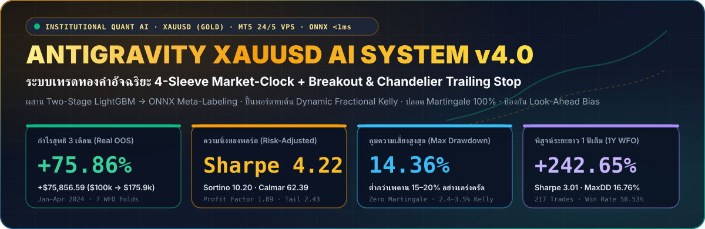

<p align="center">
  
</p>

# 📘 คู่มือปฏิบัติการฉบับสมบูรณ์ (Thai Operational Manual)

> เอกสารฉบับนี้ออกแบบมาเพื่อให้คุณสามารถ **ติดตั้ง ปรับจูน และดูแลรักษาระบบเทรดอัตโนมัติ Antigravity XAUUSD AI v4.0 บน Windows VPS ตลอด 24 ชั่วโมง 5 วันทำการ** ได้ด้วยตัวเองอย่างมั่นใจ แม้ไม่มีพื้นฐานคณิตศาสตร์ขั้นสูง

---

## 📑 สารบัญคู่มือ

1. [เช็กลิสต์เตรียมโปรแกรม MetaTrader 5 ก่อนเริ่มรันจริง](#-1-เช็กลิสต์เตรียมโปรแกรม-metatrader-5-ก่อนเริ่มรันจริง)
2. [ขั้นตอนการติดตั้งและรันบอทบน Windows VPS ทีละบรรทัด](#-2-ขั้นตอนการติดตั้งและรันบอทบน-windows-vps-ทีละบรรทัด)
3. [วิธีตั้งให้บอทเปิดตัวเองอัตโนมัติเมื่อ VPS รีสตาร์ท (24/5 Auto-Start)](#-3-วิธีตั้งให้บอทเปิดตัวเองอัตโนมัติเมื่อ-vps-รีสตาร์ท-245-auto-start)
4. [คัมภีร์แปลความหมาย `config.yaml` ครบทุกบรรทัด](#-4-คัมภีร์แปลความหมาย-configyaml-ครบทุกบรรทัด)
5. [วิธีตรวจดูบันทึกการตัดสินใจของ AI ย้อนหลัง (Audit Database)](#-5-วิธีตรวจดูบันทึกการตัดสินใจของ-ai-ย้อนหลัง-audit-database)
6. [คำถามที่พบบ่อย & วิธีแก้ปัญหาเบื้องต้น (FAQ & Troubleshooting)](#-6-คำถามที่พบบ่อย--วิธีแก้ปัญหาเบื้องต้น-faq--troubleshooting)

---

## ✅ 1. เช็กลิสต์เตรียมโปรแกรม MetaTrader 5 ก่อนเริ่มรันจริง

ก่อนสั่งรันบอทในโหมดเชื่อมต่อพอร์ตจริง (`train-mt5` หรือ `live-mt5`) ให้เปิดโปรแกรม **MetaTrader 5** บน Windows VPS และตรวจสอบ 4 จุดสำคัญนี้:

1. **เปิดปุ่ม Algo Trading ให้เป็นสีเขียว:**
   * ไปที่เมนูด้านบน **`Tools` -> `Options` -> แท็บ `Expert Advisors`**
   * ติ๊กถูกที่ช่อง **`Allow algorithmic trading`** แล้วกด `OK`
2. **เช็กชื่อสัญลักษณ์ทองคำในหน้าต่าง Market Watch (`Ctrl + M`):**
   * โบรกเกอร์ส่วนใหญ่ใช้ชื่อ **`XAUUSD`** แต่บางโบรกเกอร์อาจมีตัวห้อยท้าย เช่น `XAUUSDm`, `XAUUSD.raw` หรือ `GOLD`
   * คลิกขวาที่สัญลักษณ์ทองคำใน Market Watch เลือก **`Show`** เพื่อให้กราฟอัปเดตราคาตลอดเวลา
   * หากโบรกเกอร์ของคุณไม่ได้ใช้ชื่อ `XAUUSD` ให้เปลี่ยนชื่อทั้งในช่อง `system.symbol` และ `symbol_spec.symbol` ในไฟล์ [`../config.yaml`](../config.yaml) ให้ตรงกับโบรกเกอร์ของคุณทุกตัวอักษร
3. **เลือกประเภทบัญชีสเปรดต่ำ (ECN / Raw Spread):**
   * แนะนำบัญชีประเภท **Raw Spread / Zero / ECN** เพื่อให้ต้นทุนการเข้าออกไม้ต่ำที่สุด และไม่ติดตัวกรอง `max_spread_points` บ่อยเกินไป
4. **สเปก Windows VPS ที่แนะนำ:**
   * Windows Server 2019/2022 หรือ Windows 10/11 (64-bit) · CPU 2 vCPU ขึ้นไป · RAM 4 GB ขึ้นไป · ตั้งค่าโซนเซิร์ฟเวอร์ใกล้กับเซิร์ฟเวอร์ของโบรกเกอร์ (เช่น London หรือ New York) เพื่อความหน่วงต่ำสุด

---

## 🖥️ 2. ขั้นตอนการติดตั้งและรันบอทบน Windows VPS ทีละบรรทัด

เปิดโปรแกรม **PowerShell** บน Windows VPS แล้วทำตามลำดับดังนี้:

```powershell
# 1. ดาวน์โหลดโปรเจกต์ลงเครื่อง VPS
git clone https://github.com/saengpech-sys/education.git
cd education

# 2. สร้างสภาพแวดล้อม Python แยกเฉพาะของบอท
python -m venv .venv
.\.venv\Scripts\Activate.ps1

# 3. ติดตั้งไลบรารี AI, ONNX Runtime และตัวเชื่อมต่อ MetaTrader 5
pip install --upgrade pip
pip install -r requirements.txt
pip install MetaTrader5

# 4. รันชุดทดสอบความถูกต้อง 17 ข้อ (ต้องขึ้น 17 passed)
pytest -v
```

### ตั้งค่ารหัสผ่านอย่างปลอดภัย (ไม่ต้องแก้รหัสลงในไฟล์โค้ด)

```powershell
$env:MT5_LOGIN="12345678"                 # เลขบัญชีเทรด MT5 ของคุณ
$env:MT5_PASSWORD="รหัสผ่านบัญชีเทรดของคุณ"   # รหัสผ่านหลัก (Master Password ไม่ใช่ Investor Password)
$env:MT5_SERVER="Exness-MT5Trial7"        # ชื่อเซิร์ฟเวอร์ของโบรกเกอร์ตามที่แสดงใน MT5
```

### เทรนสมองกล `.onnx` จากกราฟจริงของโบรกเกอร์คุณ (ทำครั้งแรกและแนะนำให้อัปเดตทุก 2–4 สัปดาห์)

```powershell
python main.py --mode train-mt5 --bars 30000
```
*ระบบจะดึงกราฟย้อนหลัง 4 ไทม์เฟรม (`M5`, `M15`, `H1`, `H4`) คำนวณ Walk-Forward ให้ดูบนหน้าจอ และบันทึกไฟล์โมเดล `primary_directional.onnx` และ `secondary_meta_confidence.onnx` ไว้ใน `artifacts/onnx_models/`*

### เริ่มรันระบบเทรดจริงตลอด 24/5

```powershell
python main.py --mode live-mt5 --config config.yaml
```

> [!TIP]
> **คำแนะนำสำหรับมือใหม่:** แนะนำให้รันบน **บัญชีทดลอง (Demo Account)** ของโบรกเกอร์เดียวกันอย่างน้อย **3–5 วันทำการ** เพื่อตรวจสอบขนาดหลอต ค่าคอมมิชชัน และเวลาเซิร์ฟเวอร์ให้มั่นใจ 100% ก่อนสลับเลขบัญชีเป็นพอร์ตเงินจริง!

---

## 🔄 3. วิธีตั้งให้บอทเปิดตัวเองอัตโนมัติเมื่อ VPS รีสตาร์ท (24/5 Auto-Start)

คุณสามารถสร้างไฟล์สคริปต์ชื่อ `start_bot_vps.ps1` ไว้ในโฟลเดอร์โปรเจกต์ เพื่อให้บอทกลับมาทำงานต่อเองอัตโนมัติแม้โปรแกรมหลุดหรือ Windows อัปเดต:

```powershell
# ไฟล์ start_bot_vps.ps1
Set-Location "C:\path\to\education"
$env:MT5_LOGIN="12345678"
$env:MT5_PASSWORD="รหัสผ่านของคุณ"
$env:MT5_SERVER="ชื่อเซิร์ฟเวอร์โบรกเกอร์"

while ($true) {
    Write-Host "[$(Get-Date)] Starting Antigravity XAUUSD AI System v4.0..."
    .\.venv\Scripts\python.exe main.py --mode live-mt5 --config config.yaml
    Write-Host "[$(Get-Date)] Process exited. Restarting in 15 seconds..."
    Start-Sleep -Seconds 15
}
```
จากนั้นนำไปผูกไว้ใน **Windows Task Scheduler** โดยตั้ง Trigger เป็น **`At log on`** เพื่อให้ทำงานทันทีที่เปิดเครื่อง VPS

---

## ⚙️ 4. คัมภีร์แปลความหมาย `config.yaml` ครบทุกบรรทัด

### หมวดที่ 1: `system` & `symbol_spec` (ข้อมูลระบบและสเปกทองคำของโบรกเกอร์)

| ชื่อตัวแปร | ค่าเริ่มต้น | ความหมายแบบเข้าใจง่าย |
| :--- | :---: | :--- |
| `system.symbol` | `"XAUUSD"` | ชื่อสัญลักษณ์ทองคำใน MT5 ของคุณ (ต้องตรงกับ `symbol_spec.symbol`) |
| `system.poll_interval_seconds` | `5.0` | ความถี่ในการเช็กแท่งเทียนใหม่และสถานะพอร์ต (ทุกๆ 5 วินาที) |
| `symbol_spec.tick_size` / `tick_value` | `0.01` / `1.00` | ทองคำมาตรฐาน `1.00 Lot` (`100 oz`) ขยับ `0.01` ดอลลาร์ = กำไร/ขาดทุน `$1.00` |
| `symbol_spec.volume_min` / `volume_step` | `0.01` / `0.01` | ขนาดหลอตต่ำสุดและสเต็ปการเพิ่มหลอตของโบรกเกอร์ |

### หมวดที่ 2: `regime_ai` (สมองกลตรวจจับสภาวะตลาดและคัดกรองความมั่นใจ)

| ชื่อตัวแปร | ค่าเริ่มต้น | ความหมายแบบเข้าใจง่าย |
| :--- | :---: | :--- |
| `abnormal_vol_zscore_ceiling` | `2.80` | หากตลาดกระชากแรงผิดปกติเกิน `2.8 SD` ระบบจะสั่งหยุดเปิดไม้ใหม่ทันทีเพื่อหลบพายุข่าว |
| `meta_confidence_threshold` | `0.46` | เกณฑ์ขั้นต่ำความน่าจะเป็นจากโมเดล AI ชั้นที่ 2 *(ค่ายิ่งสูง = ยิ่งเลือกเข้าเฉพาะไม้ที่มั่นใจสุดๆ จำนวนไม้จะลดลงแต่แม่นยำขึ้น)* |
| `triple_barrier_sl_atr` | `1.50` | ระยะตัดขาดทุนมาตรฐาน คิดเป็น `1.50 เท่า` ของความผันผวนจริง (`ATR`) ณ เวลานั้น |
| `triple_barrier_pt_atr` | `3.30` | เป้าทำกำไรพื้นฐาน `3.30 ATR` (`2.2R`) *(และขยายเป็น `6.0 ATR` หรือ `4.0R` อัตโนมัติในโหมด Chandelier รันเทรนด์)* |

### หมวดที่ 3: `risk_and_scaling` (หัวใจหลักของการปั้นพอร์ตทบต้นและเบรกเกอร์นิรภัย)

| ชื่อตัวแปร | ค่าเริ่มต้น (v4) | ความหมายแบบเข้าใจง่าย |
| :--- | :---: | :--- |
| `min_risk_per_trade_pct` | `0.0240` (`2.40%`) | ความเสี่ยงขั้นต่ำต่อไม้เมื่อสัญญาณผ่านด่าน AI |
| `max_risk_per_trade_pct` | `0.0350` (`3.50%`) | เพดานความเสี่ยงสูงสุดต่อไม้ ระบบล็อกไม่ให้เกินค่านี้เด็ดขาด (ปลอด Martingale 100%) |
| `kelly_fraction` | `0.35` | ตัวคูณย่อส่วนสูตร Kelly Criterion เพื่อเร่งพอร์ตทบต้นอย่างสมดุล |
| `daily_drawdown_limit_pct` | `0.075` (`7.5%`) | **เบรกเกอร์รายวัน:** หากวันนั้นพอร์ตย่อแตะ `7.5%` ระบบตัดเข้าโหมด `COOLDOWN` หยุดเปิดไม้ใหม่ทันที |
| `max_trailing_drawdown_limit_pct` | `0.170` (`17.0%`) | **เบรกเกอร์สะสมจากจุดสูงสุด:** หากพอร์ตย่อจาก High เดิมแตะ `17.0%` ระบบหยุดพักและเข้าโหมดฟื้นฟู |
| `cooldown_minutes` | `240` (`4 ชม.`) | ระยะเวลาพักพอร์ตขั้นต่ำเมื่อเบรกเกอร์ทำงาน ก่อนอนุญาตให้เข้าสู่โหมดฟื้นฟู |
| `recovery_lot_multiplier` | `0.50` (`ลดครึ่งหนึ่ง`) | ในช่วงฟื้นฟูหลังพ้น Cooldown ระบบจะลดขนาดหลอตลงเหลือ **ครึ่งเดียว (`0.5x`)** อัตโนมัติจนกว่าพอร์ตจะทำกำไรกลับมา |
| `max_lot_per_order` | `10.00` | หากพอร์ตใหญ่จนต้องเปิดเกิน `10 Lot` ระบบจะไม่ยิงก้อนเดียว แต่จะ **ซอยไม้ย่อย (TWAP / Iceberg)** อัตโนมัติเพื่อไม่ให้โดนโบรกเกอร์ลากราคา (Slippage) |

### หมวดที่ 4: `execution_and_monitoring` (ตัวกรองสเปรด ช่วงเวลาอันตราย และฐานข้อมูล)

| ชื่อตัวแปร | ค่าเริ่มต้น | ความหมายแบบเข้าใจง่าย |
| :--- | :---: | :--- |
| `max_spread_points` | `35.0` | ห้ามเข้าออเดอร์เด็ดขาดหากสเปรดทองถ่างเกิน `35 points` (`$0.35`) |
| `rollover_start_utc` / `end_utc` | `"23:50"` – `"00:15"` | งดเทรดช่วงตลาดเปลี่ยนวัน (`06:50 – 07:15 น.` เวลาไทย) ซึ่งเป็นช่วงสเปรดถ่างกว้างที่สุดของวัน |
| `friday_stop_hour_utc` | `21` | หยุดเปิดไม้ใหม่ในคืนวันศุกร์ตั้งแต่ `21:00 UTC` (`04:00 น.` เช้าวันเสาร์เวลาไทย) เพื่อป้องกันความเสี่ยงถือข้ามเสาร์-อาทิตย์ |
| `news_blackout_before/after_minutes` | `30` / `30` | งดเปิดออเดอร์ก่อนและหลังข่าวเศรษฐกิจระดับรุนแรง (High-Impact News) เป็นเวลา `30 นาที` |

---

## 🗄️ 5. วิธีตรวจดูบันทึกการตัดสินใจของ AI ย้อนหลัง (Audit Database)

ทุกๆ รอบที่ AI ประเมินตลาด (ทั้งจังหวะที่ **ตัดสินใจเข้าเทรด** และจังหวะที่ **สั่งปฏิเสธสัญญาณ**) ระบบจะบันทึกเหตุผล ความมั่นใจ และค่าฟีเจอร์ไว้ในไฟล์ฐานข้อมูล `artifacts/trading_audit.db` คุณสามารถรันคำสั่ง Python สั้นๆ นี้เพื่อดู 10 รายการล่าสุดได้ทันที:

```bash
python -c "import sqlite3, pandas as pd; con=sqlite3.connect('artifacts/trading_audit.db'); print(pd.read_sql_query('SELECT timestamp_utc, regime, primary_side, meta_win_probability, approved, rejection_reason FROM ai_decisions ORDER BY id DESC LIMIT 10', con).to_string(index=False))"
```

---

## ❓ 6. คำถามที่พบบ่อย & วิธีแก้ปัญหาเบื้องต้น (FAQ & Troubleshooting)

<details>
<summary><strong>Q1: ทำไมสั่งรัน <code>live-mt5</code> แล้วขึ้นแจ้งเตือน <code>ONNX model files not found</code>?</strong></summary>

* **สาเหตุ:** ยังไม่ได้สร้างไฟล์สมองกล `.onnx` ลงในโฟลเดอร์ `artifacts/onnx_models/`
* **วิธีแก้:** รันคำสั่ง `python main.py --mode train-mt5 --bars 30000` (เมื่อต่อกับ MT5 จริง) หรือ `python main.py --mode demo-pipeline` ก่อน 1 ครั้ง ระบบจะสร้างไฟล์ `.onnx` ทั้งสองไฟล์ให้ทันที
</details>

<details>
<summary><strong>Q2: ทำไมเปิดบอททิ้งไว้หลายชั่วโมงแล้วยังไม่ยอมเปิดออเดอร์เลย?</strong></summary>

* **คำตอบ:** **เป็นพฤติกรรมปกติและเป็นจุดแข็งของระบบครับ!** บอทตัวนี้จะไม่เปิดออเดอร์มั่วตลอดเวลา แต่จะรอเฉพาะช่วงเวลาทองของสถาบันทั้ง **4 โซนเวลา** (`03:45–04:30 น.`, `19:00–23:25 น.`, และ `23:30–02:55 น.` ตามเวลาไทย) และจะยิงออเดอร์ก็ต่อเมื่อโมเดล AI ชั้นที่ 2 ประเมินว่าโอกาสชนะสูงเกินเกณฑ์พร้อมสเปรดไม่ถ่างเท่านั้น
</details>

<details>
<summary><strong>Q3: ถ้ามีทุนเริ่มต้นน้อย เช่น `$500` หรือ `$1,000` สามารถใช้งานได้ไหม?</strong></summary>

* **คำตอบ:** **ใช้งานได้ครับ!** เพราะระบบคำนวณขนาดไม้เป็นเปอร์เซ็นต์ความเสี่ยงต่อ Equity ปัจจุบัน (`Inverse Volatility Position Sizing`) หากพอร์ตขนาด `$1,000` และตั้งความเสี่ยง `2.4%` (`$24` ต่อไม้) เมื่อระยะ Stop Loss กว้างประมาณ `$4.50` ระบบจะออกหลอตประมาณ `0.05 Lot` อัตโนมัติ *(สำหรับพอร์ตต่ำกว่า `$300` แนะนำให้ใช้บัญชีประเภท **Cent Account** เพื่อให้ระบบซอยหลอตละเอียดได้อย่างแม่นยำ)*
</details>

<details>
<summary><strong>Q4: ควรสั่งเทรนโมเดลใหม่ (`--mode train-mt5`) บ่อยแค่ไหน?</strong></summary>

* **คำตอบ:** แนะนำให้รันอัปเดตโมเดลใหม่ **ทุกๆ 2 ถึง 4 สัปดาห์** ในช่วงวันเสาร์หรืออาทิตย์ที่ตลาดปิด (หรือคืนวันศุกร์หลังปิดตลาด) เพื่อให้โมเดล LightGBM → ONNX ซึมซับระดับความผันผวนล่าสุดของตลาดทองคำอยู่เสมอ
</details>

---

<p align="center">
  <a href="../README.md"><strong>⬅️ กลับสู่หน้าหลักของโปรเจกต์ (README.md)</strong></a>
</p>
